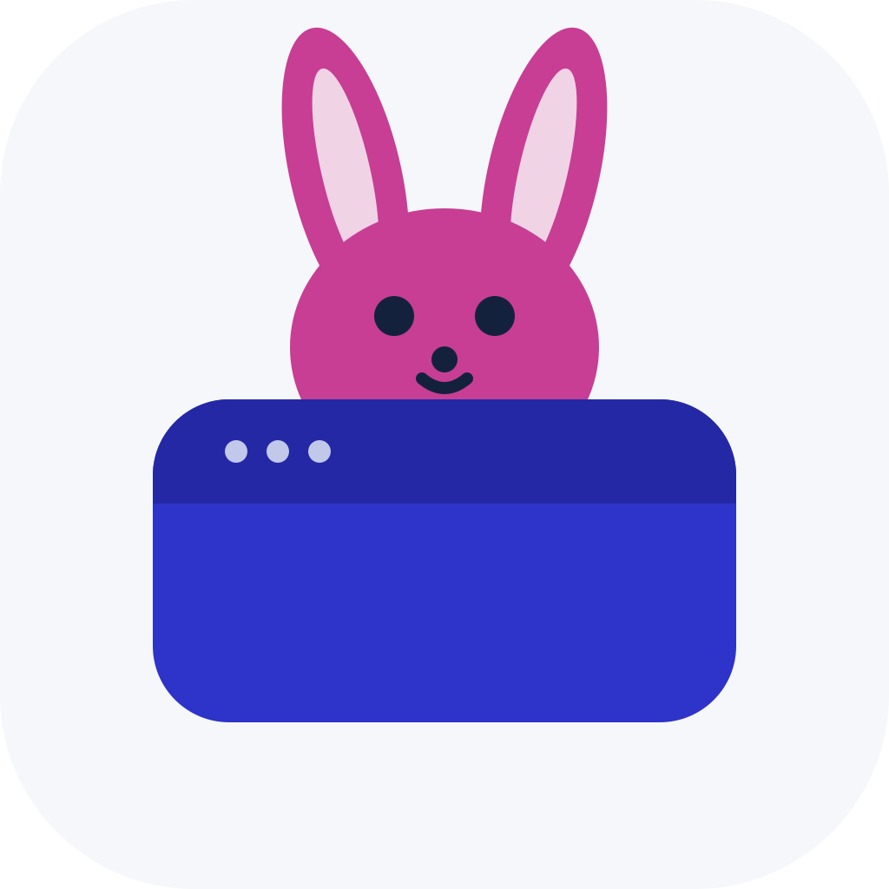
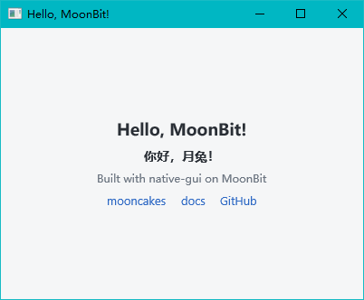
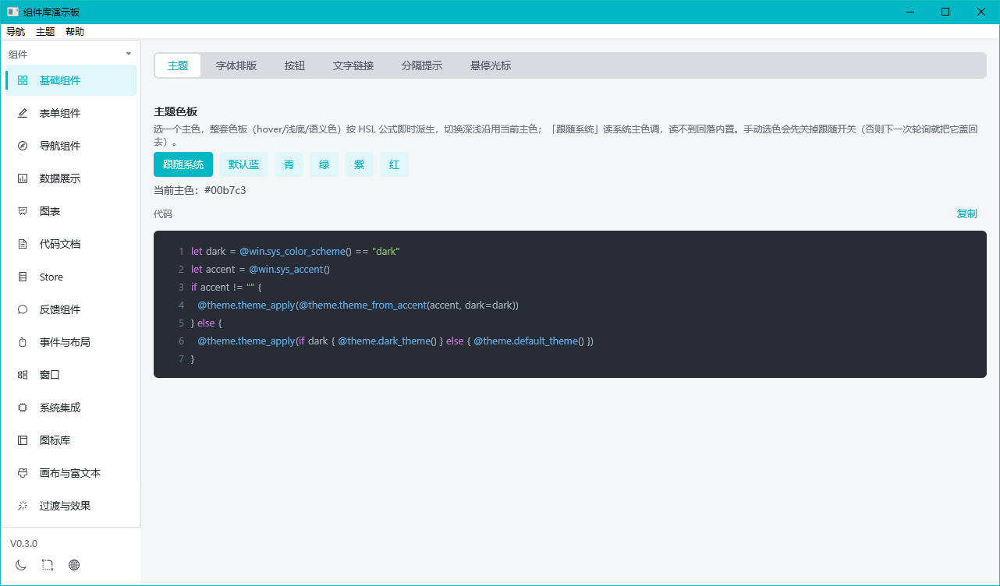
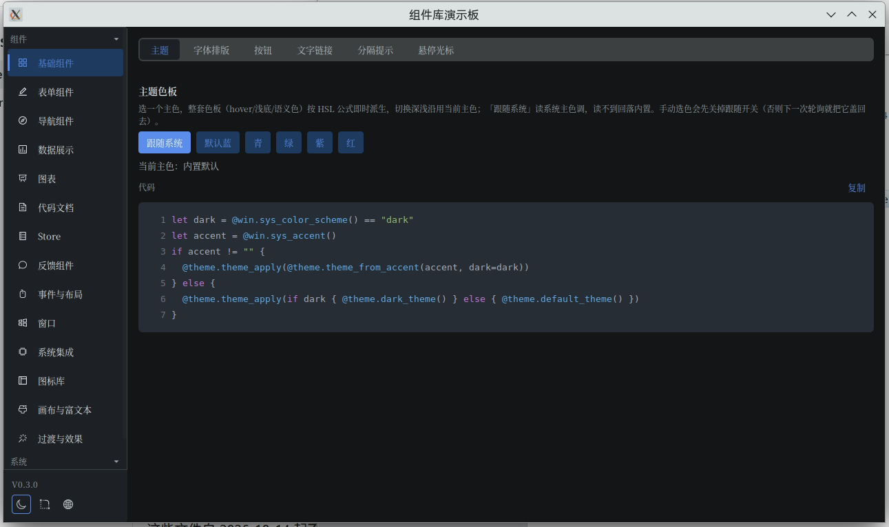
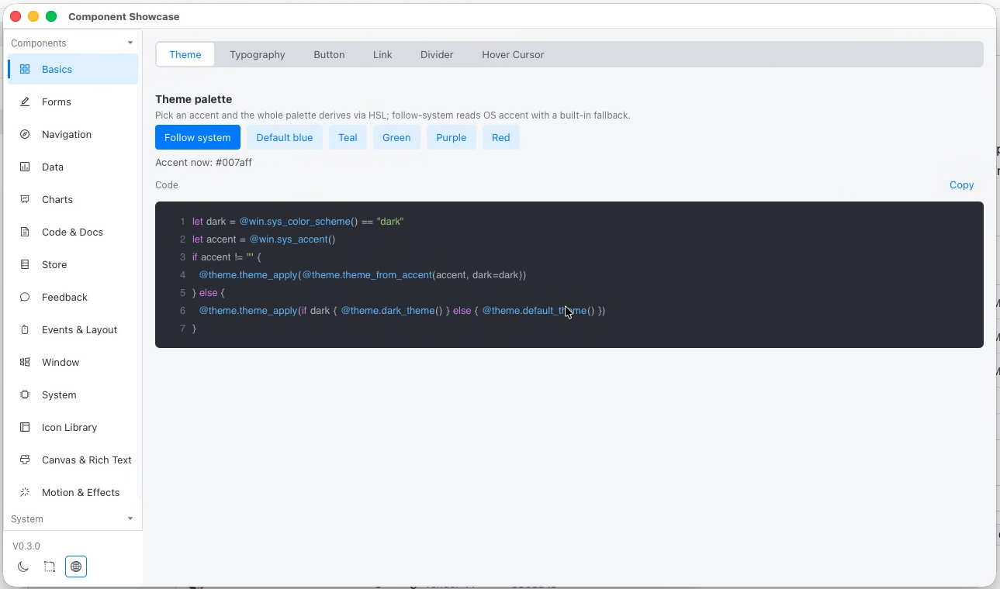
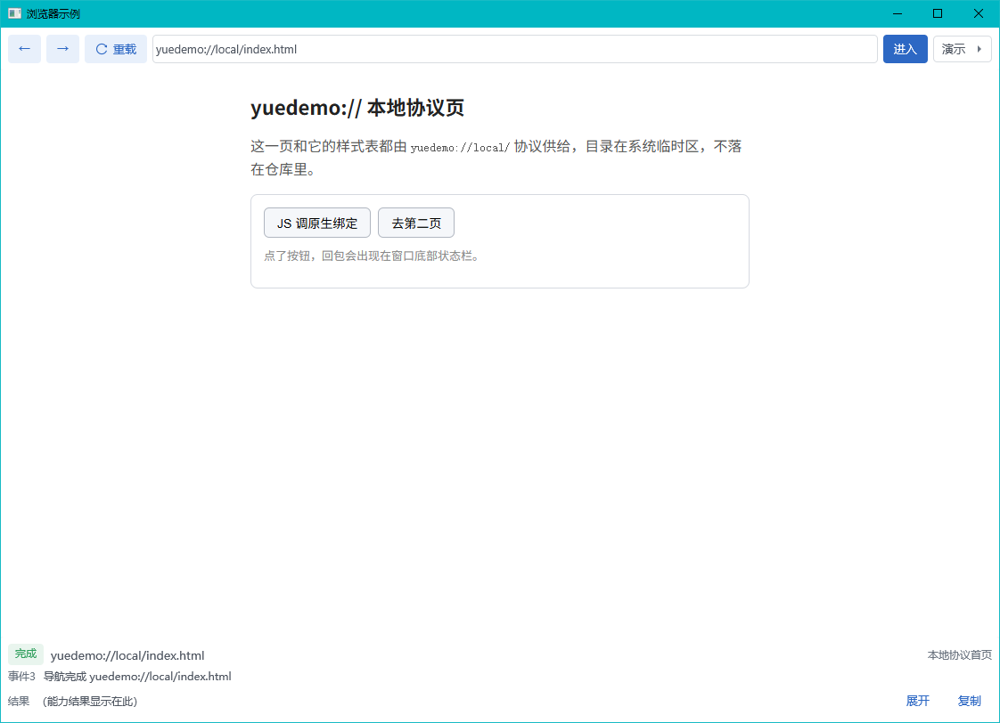
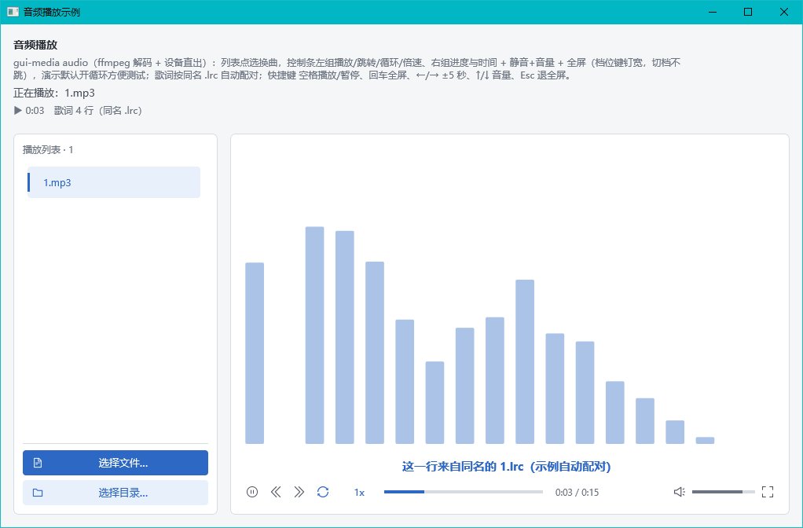
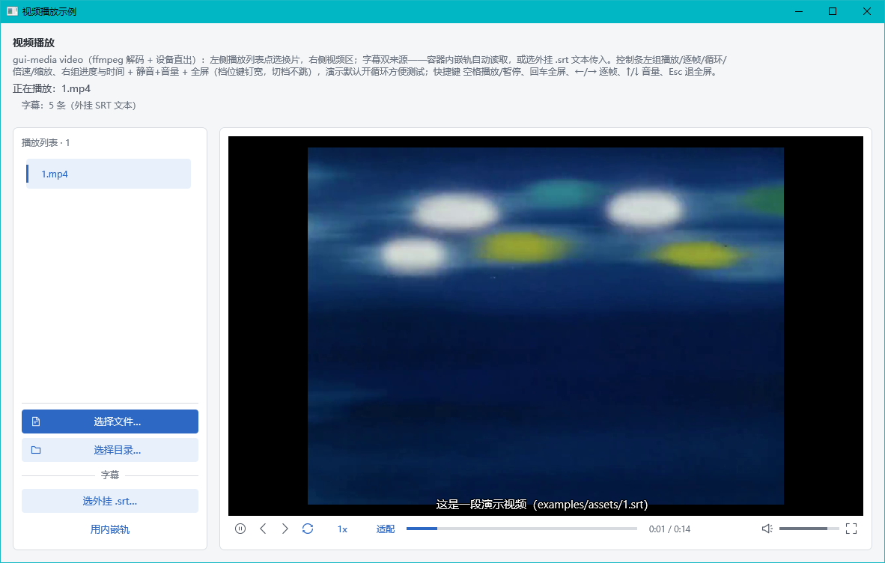

<p align="center"></p>

# native-gui [](https://github.com/lb091188/moonbit-native-gui/actions/workflows/ci.yml)

> **Where it came from**: this library started as a MoonBit binding of [Cheng Zhao (zcbenz)](https://github.com/zcbenz)'s [Yue / libyue](https://github.com/yue/yue), with layout following [Yoga](https://github.com/facebook/yoga)'s flexbox. Neither is a runtime dependency any more — both stay as references for behaviour and as sources of material. Thanks also to [MoonBit](https://github.com/moonbitlang).

A **cross-platform desktop GUI framework** for [MoonBit](https://github.com/moonbitlang) — one MoonBit codebase ships native windows on Windows 🟩 / Linux 🟩 / macOS 🟩, with tray, notifications, shortcuts, file dialogs and other desktop capabilities ready to use.

English | [简体中文](README_ZH.md)

## Quick start

- [Experience guide](https://moonbit-native-gui.pages.dev/experience): run the five prebuilt demo apps, no code needed.
- [App development](https://moonbit-native-gui.pages.dev/dev-experience): build desktop applications with MoonBit and native-gui.
- [Build & run](https://moonbit-native-gui.pages.dev/build): working on the `native-gui` library itself.
- [Package layout](https://moonbit-native-gui.pages.dev/packages): the 15 package aliases and the two optional modules at a glance.

📚 **Documentation**: <https://moonbit-native-gui.pages.dev/>









## Highlights

**🖥 Full system surfaces** — tray, notifications, global shortcuts, clipboard, native menus, file dialogs, drag & drop, autostart and other desktop essentials work out of the box, plus system queries for volume / power / wallpaper / monitors / printers.

**🎨 Consistent look, lightweight** — no heavyweight graphics engine; the same widget appearance on all three platforms, with small artifacts and fast startup. Follows the system light/dark mode and accent colour by default, theme fully customizable; built-in control text is localizable (English and Chinese ship with the package).

**📊 A complete widget set** — layout primitives, form controls, interactive charts, Markdown rendering; separately, `gui-media` brings audio/video playback and display, and `gui-webview` brings web rendering on the system webview.

**📝 Declarative UI and reactive state** — the interface is described as a tree and mounted in one `mount_window` call; state lives in `Store` / `Signal`, and bound spots refresh with the data:

```moonbit
fn main {
  let app = match @ui.mount_window(
    [@ui.text("Hello, MoonBit!", font_size=18.0)],
    title="Hello, MoonBit!",
    width=400,
    height=300,
  ) {
    None => {
      // no window backend or no display service on this host
      return
    }
    Some(a) => a
  }
  app.run()
}
```

> `cd examples/showcase && moon run .` — the demo board: basic components, interactive icons, system surfaces.

## Ecosystem position

GUI capability in the MoonBit ecosystem has more than one lane: [MoUI](https://github.com/wzzc-dev/MoUI) is built on the Skia rendering engine and targets interface logic shared across platforms, while native-gui renders through the system and aims at **one-stop delivery for desktop apps** — system capabilities out of the box, common widgets consistent across platforms, everyday applications finished in one place.


## Platform support

| Platform | Status | Notes |
|---|---|---|
| Ubuntu 24.04 | ✅ | XFCE / GNOME / KDE / Cinnamon |
| Deepin 23 / 25 | ✅ | |
| Deepin 20 | ❌ | waiting on MoonBit to fix the build for Deepin 20 — see [Build & run](https://moonbit-native-gui.pages.dev/build) |
| Windows 10 / 11 | ✅ | |
| macOS | ✅ | Apple Silicon |

## Contributing

Platform compatibility reports, widgets and documentation are all welcome. The basics:

- **Commit gate**: in `gui/`, `moon check` plus `moon test ui render text theme icons sys input win dbus chart mdview style base shell widget` must be clean — zero errors, zero warnings
- **Write down what you learn**: field-tested pitfalls and fixes are recorded with the code, not only in commit messages
- **Small batches**: one coherent change per commit, short commit messages
- **Roadmap**: what is done and what comes next is on the [roadmap](https://moonbit-native-gui.pages.dev/zh/roadmap) (Chinese)
- **Full guide**: [CONTRIBUTING.md](CONTRIBUTING.md) — layout rules, design stance, test split, commit and PR conventions

[Build & run](https://moonbit-native-gui.pages.dev/build): environment from scratch, build commands and artefact paths, prebuilt binaries, failure → fix, plus the linking mechanism and how to add an example module.

## License

`native-gui` is released under the [MIT License](LICENSE). Third-party assets and their licenses are listed in [THIRD-PARTY-NOTICES.md](docs/THIRD-PARTY-NOTICES.md).

## References

- [MoonBit documentation](https://docs.moonbitlang.cn/)
- Projects this library learned from: [Yue / libyue](https://github.com/yue/yue) · [Yoga](https://github.com/facebook/yoga)
