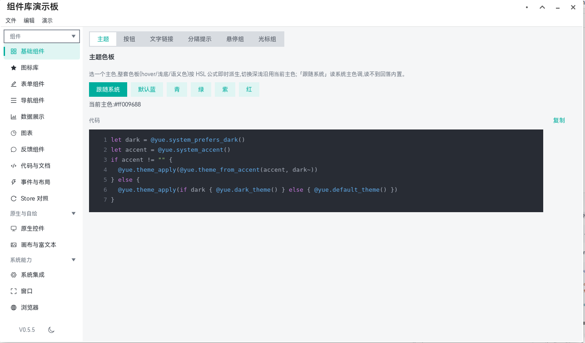
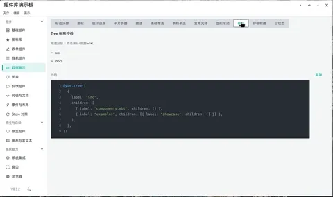
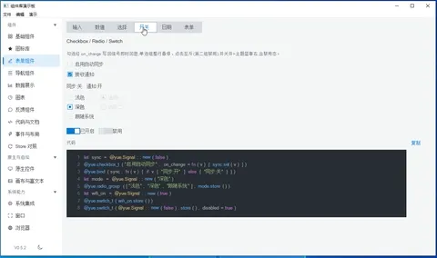

# native-gui [](https://github.com/lb091188/moonbit-native-gui/actions/workflows/ci.yml)

> **来时的路**：本库最初是 [赵成(zcbenz)](https://github.com/zcbenz) 的 [Yue / libyue](https://github.com/yue/yue) 的 MoonBit 封装，如今`libyue`、`yoga`不再是运行时依赖，只作行为参考。感谢 libyue、yoga、[MoonBit](https://github.com/moonbitlang)。

[MoonBit](https://github.com/moonbitlang) 的**跨平台桌面 GUI 框架** —— 一套 MoonBit 代码直出 Windows 🟩 / Linux 🟩 / macOS 🟩 原生窗口，托盘、通知、快捷键、文件对话框等系统能力开箱即用，`moon add` 后零配置直接运行。

[English](README.md) | 简体中文

## 快速开始

- [体验文档](https://moonbit-native-gui.pages.dev/zh/experience)：预构建包直接试跑五个演示应用。
- [应用开发](https://moonbit-native-gui.pages.dev/zh/dev-experience)：使用 moonbit 和 native-gui 构建桌面应用程序。
- [构建与运行](https://moonbit-native-gui.pages.dev/zh/build)：参与 `native-gui` 库的开发。
- [包结构](https://moonbit-native-gui.pages.dev/zh/packages)：15 个包别名与两个独立模块的一览。

📚 [**在线文档**](https://moonbit-native-gui.pages.dev/zh/)


 


## 核心特色

**🖥 系统接口完备** —— 托盘、通知、全局快捷键、剪贴板、原生菜单、文件对话框、拖放、开机自启等桌面常用能力开箱即用，另有音量 / 电源 / 壁纸 / 显示器 / 打印机等系统查询能力

**🎨 渲染管线自绘** —— 不依赖 Skia 等重型图形引擎，控件观感跨平台一致，默认跟随系统强调色与明暗模式，主题可按需定制。

**📊 界面组件齐全** —— 基础布局组件、表单组件、可交互图表、Markdown 渲染；另有独立的 gui-media 音视频播放和展示能力、gui-webview 基于系统 webview 的 web 渲染能力。

**📝 声明式 UI 与响应式状态** —— 界面以树描述，`mount_window` 一步挂载；状态放 `Store` / `Signal`，绑定点随数据自动刷新：

```moonbit
fn main {
  let app = match @ui.mount_window(
    [@ui.text("Hello, MoonBit!", font_size=18.0)],
    title="Hello, MoonBit!",
    width=400,
    height=300,
  ) {
    None => {
      // 本平台没有窗口后端或没有显示服务
      return
    }
    Some(a) => a
  }
  app.run()
}
```

> `cd examples/showcase && moon run .` —— 演示板：基础组件、交互图标、系统接口。

## 生态坐标

MoonBit 生态的 GUI 能力各有分工：[MoUI](https://github.com/wzzc-dev/MoUI) 基于 Skia 渲染引擎，面向多端共享界面逻辑；而 native-gui 基于系统渲染，定位**桌面应用的一站式交付**，力求让系统能力开箱即用，常用组件跨平台统一，日常应用一站式完成。


## 平台支持

| 平台 | 状态 | 说明 |
|---|---|---|
| Ubuntu 24.04 | ✅ | XFCE / GNOME / KDE / Cinnamon |
| Deepin 23 / 25 | ✅ | |
| Deepin 20 | ❌ | 待 MoonBit 修复 Deepin 20 的编译，详见 [构建与运行](https://moonbit-native-gui.pages.dev/zh/build) |
| Windows 10 / 11 | ✅ |  |
| macOS | ✅ | Apple Silicon  |

## 参与贡献

报平台兼容问题、补控件、补文档都欢迎。基本要求：

- **提交门禁**：库模块在 `gui/` 下 `moon check` + `moon test ui render text theme icons sys input win dbus chart mdview style base shell widget` 零错误零警告
- **经验留档**：实测坑与修复随代码记录，不要只留在提交信息里
- **小批次**：一个提交一个内聚改动，提交信息简短
- **进度与计划**：功能面全景与后续待做见[路线图](https://moonbit-native-gui.pages.dev/zh/roadmap)

[构建与运行](https://moonbit-native-gui.pages.dev/zh/build)：从零装环境、构建与产物落点、预构建二进制、常见失败处置，以及链接参数托管与新增示例模块的机制。

## 许可

`native-gui` 以 [MIT 许可](LICENSE) 发布。第三方资产的授权与来源见 [THIRD-PARTY-NOTICES.md](docs/THIRD-PARTY-NOTICES.md)。

## 参考

- [MoonBit 文档](https://docs.moonbitlang.cn/)
- 本库从中学习过思路的项目：[Yue / libyue](https://github.com/yue/yue) · [Yoga](https://github.com/facebook/yoga)
